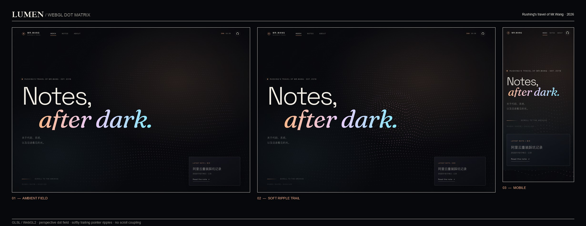

# Rushing's travel of Mr.Wang

Personal Astro blog for [rushwang.blog](https://rushwang.blog).

**Theme: Lumen** — a dark, cinematic editorial layout with a live WebGL dot-matrix background, large-scale typography, and a poster-style article archive.



[观看点阵背景动图](dot-matrix-preview.gif)

## Stack

- Astro 7 content collections + Markdown
- `astro:assets` for optimized local images
- Local fonts registered with Astro's `fontProviders.local()` (Space Grotesk + Fraunces)
- Custom WebGL2 dot-matrix shader (perspective grid, ambient waves, soft trailing pointer ripples)
- Vanilla TypeScript for scroll reveals, header state, and reading progress
- RSS + sitemap enabled

## Commands

```bash
npm install
npm run dev
npm run build
npm run preview
```

## Structure

```text
src/
├── assets/
│   ├── fonts/          # local webfonts
│   └── images/         # post cover photography
├── components/         # header, footer, post cards, dot-matrix canvas
├── content/blog/       # Markdown posts
├── layouts/            # BaseLayout + BlogPost
├── pages/              # home, archive, about, dynamic posts, RSS
├── scripts/
│   ├── lumen.ts        # header, reveal, reading progress
│   └── dot-matrix.ts   # WebGL2 dot field + trailing pointer ripples
└── styles/global.css   # Lumen design system
```

## Content

Posts live in `src/content/blog`. Each post can declare a local `heroImage` in frontmatter; the image is automatically optimized at build time and used both in the poster archive and on the article page.

Photography is sourced from Unsplash and committed locally. The homepage uses the moving dot field as its opening image; photography remains in the article covers and the About page.

## Dot-matrix background

The field is built from a perspective grid of GPU points. Ambient waves animate continuously; moving the pointer leaves a soft trail of small, expanding ripples behind the cursor. The page scroll is intentionally **not** wired to the field, so scrolling only moves the page content and never triggers a particle disturbance.

The interaction is inspired by point-field and fluid studies such as [DeepSeek's dot-matrix whale wallpaper](https://github.com/HeShen-1/deepseek-whale-wallpaper), [WebGL Water](https://madebyevan.com/webgl-water/), and [three.js `webgl_points_waves`](https://threejs.org/examples/#webgl_points_waves). The shader is a dependency-free implementation tuned to the site's warm/cool Lumen palette.

It respects `prefers-reduced-motion` and falls back to a static CSS dot field when WebGL2 is unavailable.
